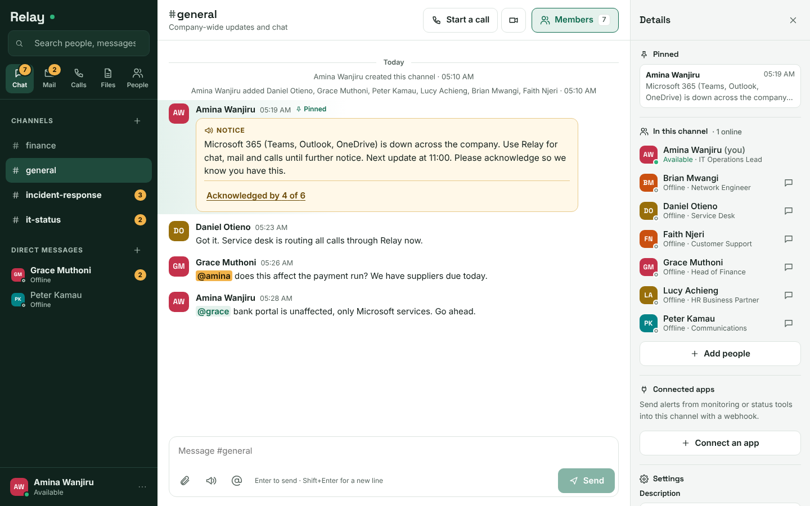
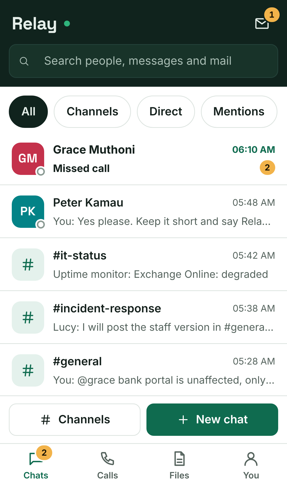
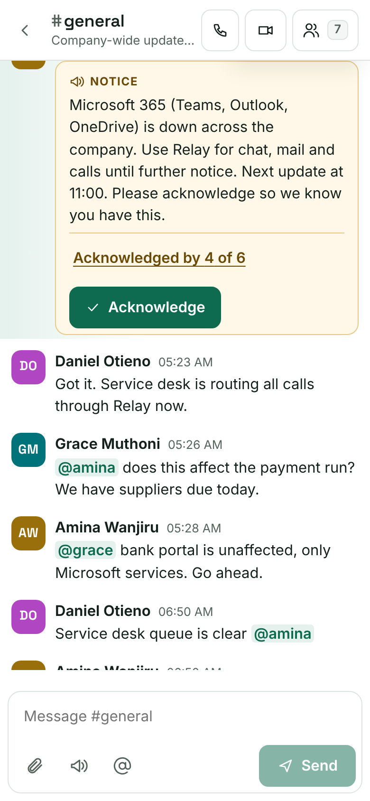
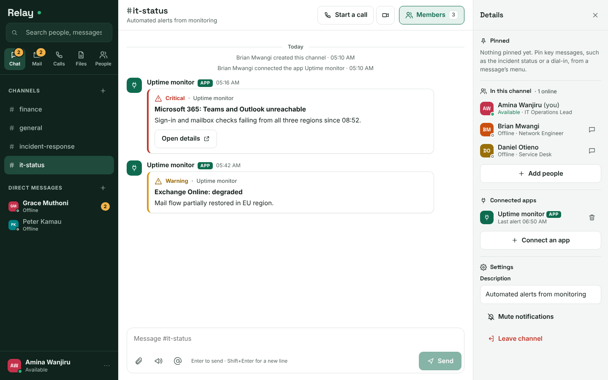

# Relay: backup chat, mail and calls

Relay is a self-hosted communication app for when your usual tools (Microsoft Teams and Outlook, Google Workspace, Slack…) are down. It combines:

- **Chat**: channels, group chats and direct messages, with @mentions, replies, line-icon reactions, pins, file sharing, typing indicators, read receipts and unread counts.
- **Notices**: a message type that asks everyone to **Acknowledge** it, so you can see who has read an outage update and who hasn't.
- **Connected apps**: incoming webhooks that post **App alert cards** into a channel (point an uptime monitor or status page at it).
- **Mail**: internal email with Inbox, Starred, Sent, Drafts (autosaved), Archive and Trash, To/Cc/Bcc, threads, reply/forward, attachments and importance flags.
- **Calls**: one-to-one and group voice/video calls with screen sharing (WebRTC), call history and missed-call notices.
- **Admin**: an announcement banner that reaches every screen at once, bulk account creation with one-time passwords, an *outage readiness* view of who has activated their account, password resets and account disabling.

It is a separate app from the PeopleFlow HR app in the repository root, with its own database and dependencies.



| Phone: chats | Phone: notice | App alerts |
|---|---|---|
|  |  |  |

More in [`docs/screenshots/`](docs/screenshots/).

## Why it's built this way

A backup channel is only useful if it doesn't fail along with the thing it backs up. So Relay:

- **Has no third-party runtime dependencies.** No Microsoft or Google sign-in, no CDN, no hosted fonts (Inter and Space Grotesk are bundled), no analytics. One Node.js process and one SQLite file.
- **Uses its own accounts.** Create them *before* an outage (Admin → Add people) and get people to activate them. The Admin readiness card shows who hasn't.
- **Hands out passwords out of band.** When email is down you can't email invites, so new accounts get a one-time password to share by SMS, printout or your HR system.
- **Reconnects on its own** after network blips and catches up on messages missed while offline.

## Run it

Requires Node.js 22.13 or later (uses the built-in `node:sqlite`; no compiler needed).

```bash
cd comms
npm install
```

Try it with demo data (7 people, channels, a notice, app alerts, mail, a missed call). Every demo account's password is `relay-demo-1`; `amina@example.com` is the admin:

```bash
npm run seed -- --reset
```

Development, with live reload (API on port 4000, UI on http://localhost:5173):

```bash
npm run dev
```

Production: build the UI once, then run a single server on `PORT` (default 4000):

```bash
npm run build
```

```bash
npm start
```

Starting with an empty database, the first person to sign up becomes the admin. After that, self sign-up is closed unless you set `RELAY_SIGNUP_CODE`, and admins create accounts.

## Tests

```bash
npm test          # server logic: auth, permissions, chat, notices, pins, mentions, webhooks, mail, files, calls
npm run typecheck
```

`npm run e2e` drives two real browsers against a running, seeded server (`RELAY_URL`, default `http://localhost:4000`): live chat with presence, a notice acknowledged by the other person, a webhook alert, a WebRTC video call with a fake camera and microphone, and mail. It needs Playwright with Chromium.

## Deploying it as a backup

Host Relay **away from the systems it backs up**: a different cloud provider or region, or a small on-premises server, and its own DNS name that doesn't depend on your main identity provider or mail host.

- **HTTPS is required** for calls (browsers only allow camera and microphone on secure origins; `localhost` is the exception). Put Relay behind a reverse proxy such as Caddy or nginx that terminates TLS and forwards WebSocket upgrades on `/ws`. Set `RELAY_TRUST_PROXY=1` so secure cookies, client IPs and login throttling use the proxy's `X-Forwarded-*` headers.
- **Calls across the internet need STUN/TURN.** On one LAN or VPN, calls connect directly with no extra setup. Across the internet, run your own TURN server (for example coturn) and set `RELAY_ICE_SERVERS`, e.g. `[{"urls":"stun:turn.example.com:3478"},{"urls":"turn:turn.example.com:3478","username":"relay","credential":"…"}]`. Relay ships with no STUN/TURN servers configured, so it never contacts a third party unless you tell it to. Group calls are peer-to-peer (mesh), which works well up to about 6–8 people.
- **Back up** the data directory (`data/relay.db` plus `data/uploads/`). SQLite runs in WAL mode; use `sqlite3 relay.db ".backup backup.db"` for a consistent copy.
- **Monitor** `GET /api/health`.
- **Run a drill** every quarter: post a test announcement, check readiness, make a test call between two offices.

| Variable | Default | Purpose |
|---|---|---|
| `PORT` / `HOST` | `4000` / `0.0.0.0` | Where the server listens |
| `RELAY_DATA_DIR` | `./data` | Database and uploaded files |
| `RELAY_DB` | `$RELAY_DATA_DIR/relay.db` | Database file |
| `RELAY_SIGNUP_CODE` | unset | Lets people create their own account with this code |
| `RELAY_ICE_SERVERS` | `[]` | JSON list of STUN/TURN servers for calls |
| `RELAY_TRUST_PROXY` | unset | Set to `1` behind a TLS-terminating proxy |
| `RELAY_MAX_UPLOAD_MB` | `25` | Largest file people can share |

## Connected apps (webhooks)

In a channel, open **Members → Connected apps → Connect an app**. You get a secret URL, shown once. Post JSON to it:

```bash
curl -X POST https://relay.example.com/api/hooks/<token> \
  -H 'Content-Type: application/json' \
  -d '{"title":"Teams is degraded","text":"Use Relay for chat and calls.","severity":"warning","link":"https://status.example.com"}'
```

`severity` is `info`, `warning`, `critical` or `resolved`. Only `http(s)` links are kept. Each app is limited to 60 alerts a minute. Disconnecting the app invalidates its URL.

## Security notes

- Passwords are hashed with scrypt. Sessions are random tokens in an HttpOnly, SameSite=Lax cookie. State-changing requests from other origins are rejected. Repeated failed logins are throttled per email and IP.
- Every chat, mail and file request is checked against membership: you can only read conversations you're in (or public channels), emails in your own mailbox, and files shared somewhere you can see. Bcc recipients are hidden from everyone except the sender.
- Message text is never rendered as HTML. Uploaded files are served as downloads, except PNG, JPEG, GIF and WebP images, which display inline. A strict Content Security Policy allows only same-origin scripts and connections.
- Webhook tokens are stored hashed.
- Mail is internal only: it does not send to or receive from outside addresses.

## Not built yet

- Sending or receiving external email (SMTP), and single sign-on (deliberately left out so an identity-provider outage can't lock people out).
- Mobile push notifications while the app is closed. Desktop notifications work while a browser tab is open; installing Relay as an app from the browser helps.
- End-to-end encryption, message retention policies and audit export.
- A media server (SFU) for large meetings.
